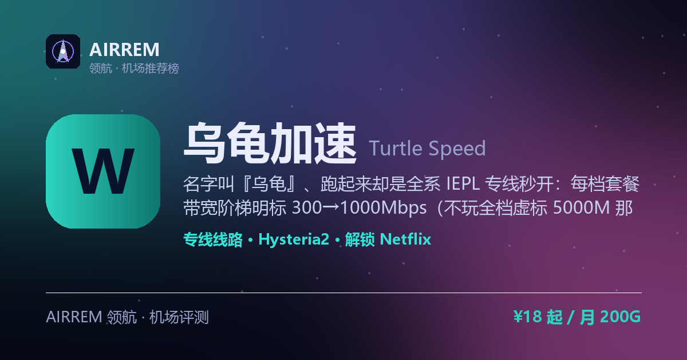

# 乌龟加速机场评测 2026：IEPL 专线 + EMBY 追剧，官网注册入口与套餐价格

> **乌龟加速** 适合谁？既要 IEPL 专线晚高峰稳，又想白嫖 EMBY 影视库追 4K，还要不限设备全家一起用。名字叫『乌龟』、跑起来却是全系 IEPL 专线秒开：每档套餐带宽阶梯明标 300→1000Mbps（不玩全档虚标 5000M 那套），赠送 EMBY 影视库追 4K，不限设备支持全家共享；月付 ¥18/200G 起，另有 3000G/6000G 不限时买断大流量包做长期备用。

👉 **[乌龟加速 官网注册入口](https://s.rtxk.us/s/5krgzu4)** ｜ [完整评测与横向对比](https://555736.xyz/wugui/)

---

## 我们的结论

乌龟加速是 2025 年上线、老板在境外的 IEPL 专线机场，卖点是「全系专线 + 赠送 EMBY + 带宽阶梯明标」三合一：从 Mini 200G/300Mbps（¥18）到 Star 1200G/1000Mbps（¥78），带宽随价位一档档往上给，不像有的新站全档都吹 5000M；每档都送 EMBY 影视库、走 IEPL 专线、不限设备并支持家庭共享，还有 3000G ¥358 / 6000G ¥658 不限时买断大包适合长期备用。注意它走纯电信 BGP 入口，移动/联通跨网体验略逊、无原生客户端要自己配、且暂不支持退款——先小额月付验证晚高峰再考虑长约。

## 基本信息

| 项目 | 内容 |
| --- | --- |
| 机场名称 | 乌龟加速（乌龟加速器 · 龟速 · WuGui） |
| 成立时间 | 2025 |
| 线路类型 | IEPL 专线（全系专线传输） |
| 支持协议 | Hysteria2 / Shadowsocks / Trojan |
| 流媒体解锁 | Netflix / Disney+ / ChatGPT / YouTube / TikTok |
| 节点地区 | 新加坡 · 香港 · 日本 · 美国 · 土耳其 等 20+ 节点（电信 BGP 入口 / Amazon 落地） |
| 计费方式 | 月付（至 3 年付）/ 不限时买断流量包 |
| 起步价格 | ¥18 / 月 200G |
| 推荐场景 | 既要 IEPL 专线晚高峰稳，又想白嫖 EMBY 影视库追 4K，还要不限设备全家一起用 |
| Emby 影音 | 支持 |

## 乌龟加速 套餐价格

| 套餐 | 价格 | 说明 |
| --- | --- | --- |
| Mini 包月200G | ¥18 | 月付（可选至 3 年付）· 每月 200G · IEPL 专线 · 300Mbps · 不限设备 · 家庭共享 · 送 EMBY |
| Pro 包月500G | ¥38 | 月付（可选至 3 年付）· 每月 500G · IEPL 专线 · 500Mbps · 不限设备 · 家庭共享 · 送 EMBY |
| Max 包月800G「火爆」 | ¥58 | 月付（可选至 3 年付）· 每月 800G · IEPL 专线 · 800Mbps · 家庭共享 · 送 EMBY |
| Star 包月1200G | ¥78 | 月付（可选至 3 年付）· 每月 1200G · IEPL 专线 · 1000Mbps · 家庭共享 · 送 EMBY |
| Max 不限时3000G | ¥358 | 一次性买断 · 3000G 用完为止 · IEPL 专线 · 1000Mbps · 家庭共享 |
| Star 不限时6000G「火爆」 | ¥658 | 一次性买断 · 6000G 用完为止 · IEPL 专线 · 1000Mbps · 家庭共享 |

> 月付套餐每月按订单日重置流量，可选月 / 季 / 半年 / 年 / 2 年 / 3 年付，带宽随档位阶梯提升（300→1000Mbps）；不限时流量包为一次性买断、用完为止、全 1000Mbps；全档走 IEPL 专线、不限设备并支持家庭成员共享，可加购流量重置包；仅限个人使用、暂不支持退款；官网以人民币计价，价格与在售套餐以官网实时为准。

## 乌龟加速是什么

乌龟加速（又称乌龟加速器 / 龟速，英文常写 Turtle Speed）是 2025 年上线的一家 IEPL 专线机场，老板身处境外。名字虽叫「乌龟」，主打的却是全系走 IEPL 专线的稳定与极速——把卖点压在「全线专线 + 赠送 EMBY 影视库 + 不限设备家庭共享」上，走的是稳定追剧路线。

最有辨识度的一点是带宽阶梯明标：不同套餐给不同带宽上限（300 / 500 / 800 / 1000Mbps），花多少钱买多大带宽一目了然，不像有的新站不分档位全都写「最高 5000Mbps」。支付方式支持支付宝 / 微信 / USDT。

## 线路与节点（全系 IEPL 专线）

乌龟加速全系套餐都标注走 IEPL 专线：数据在内网专线传输、不经公共互联网中转，延迟低、晚高峰不易拥堵，这也是它比普通中转机场稍贵的原因。入口为电信 BGP，因此电信宽带用户体验最佳。

- 覆盖新加坡 / 香港 / 日本 / 美国 / 土耳其 等 20+ 节点，落地 ISP 多为 Amazon
- 全档 IEPL 专线传输，带宽随套餐阶梯提升：300 → 500 → 800 → 1000Mbps
- 不限制设备数量，支持家庭成员共享

> 💡 纯电信 BGP 入口对移动 / 联通用户跨网性能略逊；机场有审计（屏蔽违法内容、不记录访问日志）。晚高峰表现请以自身线路小额验证为准。

## 协议与客户端

乌龟加速采用 Hysteria2（Hy2）等较新协议抗封，订阅同时兼容 Shadowsocks / Trojan 等主流格式。由于目前没有官方原生客户端，需要自行把订阅导入通用客户端；因含 Hy2，建议用 mihomo 内核客户端（Clash Verge / FlClash / Karing 等），老客户端可能不识别。

> 💡 协议与订阅格式以官网面板实际下发为准；导入后若订阅过期，重新复制订阅链接再导入即可。

## 解锁与 EMBY 影视库

解锁与影音是乌龟加速的重点：常规解锁 Netflix、Disney+、ChatGPT、YouTube、TikTok 等平台；更大的诱惑是每档套餐都赠送 EMBY 影视库，内置海量 4K 影视资源，等于「机场 + 影视库」二合一，追剧党不用再单独养一个 Emby 号。

- 流媒体 / AI：Netflix、Disney+、ChatGPT、YouTube、TikTok
- 全套餐赠送 EMBY 影视库，海量 4K 资源，Emby 客户端登录即看
- 配合 IEPL 专线 + 高带宽档，晚高峰 4K 更从容

## 优点与缺点

**✅ 优点**

- 全系走 IEPL 专线 + 每档赠送 EMBY 影视库：晚高峰追 4K 稳，追剧不用再单独养 Emby 号
- 带宽阶梯明标 300→500→800→1000Mbps，花多少钱买多大带宽一目了然，不玩全档虚标
- 不限设备、支持家庭成员共享，一份订阅全家一起用
- 计费灵活：月付 ¥18/200G 起（可选至 3 年付），另有 3000G/6000G 不限时买断大流量包做长期备用
- 支付宝 / 微信 / USDT 均可付，Hysteria2 抗封协议

**⚠️ 缺点**

- 纯电信 BGP 入口，电信用户体验最佳，移动 / 联通跨网性能略逊
- 无原生客户端，需自行把订阅导入 Clash / mihomo 等，新手有一点门槛
- 买的是全系专线，价格比普通中转机场略贵，且暂不支持退款
- 2025 年新站、境外老板，公开第三方实测偏少；机场行业有跑路风险，建议先小额月付验证再考虑长约

## 适合谁 / 不适合谁

| 👍 适合 | 👎 不适合 |
| --- | --- |
| 电信宽带、要 IEPL 专线晚高峰稳定看 4K 的用户 | 移动 / 联通为主、对跨网延迟敏感的用户 |
| 想白嫖 EMBY 影视库追剧、不愿单独养 Emby 的用户 | 要原生客户端、开箱即用零配置的纯小白 |
| 全家 / 多设备一起用、要不限设备家庭共享的用户 | 只认老牌、要长期第三方实测口碑的用户 |
| 想一次性买断 3000G / 6000G 大流量包做长期备用的用户 |  |

## 常见问题

**Q：乌龟加速是专线机场吗？**

A：是。它全系套餐都标注走 IEPL 专线（内网专线传输、不经公网中转），配电信 BGP 入口，主打晚高峰稳定，这也是它比普通中转机场稍贵的原因。追求极致稳定的重度用户，可再搭一家老牌 IPLC 专线机场做容灾。

**Q：『乌龟加速』送的 EMBY 影视库怎么用？**

A：购买任意套餐后机场会附赠 EMBY 影视库，内置海量 4K 影视资源，在 Emby 客户端登录即可直接追剧，等于机场 + 影视库二合一，省去单独养 Emby 号的钱。具体开通方式以购买后官网 / 面板说明为准。

**Q：带宽 300M 和 1000M 差在哪？该买哪档？**

A：乌龟把带宽按套餐阶梯明标：Mini 200G 是 300Mbps、Pro 500G 是 500Mbps、Max 800G 是 800Mbps、Star 1200G 与不限时大包是 1000Mbps。日常刷剧上网 Mini / Pro 足够，多设备同时 4K 或下载党选 Max / Star；拿不准就先月付低档验证，再升档或转不限时买断。

**Q：乌龟加速会不会跑路？**

A：它 2025 年才上线、老板在境外，公开独立实测偏少，且暂不支持退款，属于需要谨慎观察的新站。稳妥做法是先用 Mini 月付小额验证晚高峰与解锁，别一上来就大额年付或买 6000G 大包，并再备一两家机场容灾。

## 同类机场推荐

拿不定主意？可以再看看这几家同类型的：

- **[西部数据](https://555736.xyz/westdata/)** — 稳定专线党，¥17 起
- **[糖果云](https://555736.xyz/candycloud/)** — 影视追剧旗舰，¥18 起
- **[红杏云](https://555736.xyz/hongxing/)** — 流媒体 / 大流量性价比，¥20 起

全部 38 家机场的横向对比与选购方法论：**[信号塔 SignalTower · 机场大全](https://555736.xyz/airports/)**

---

数据更新：2026-07 ｜ 价格、套餐与优惠码以官网实时为准 ｜ 本仓库为第三方评测整理，与 乌龟加速 官方无隶属关系 ｜ 请遵守当地法律法规使用网络服务。

关键词：乌龟加速、乌龟加速机场、乌龟加速怎么样、乌龟加速靠谱吗、乌龟加速官网、乌龟加速评测、乌龟加速优惠码、乌龟加速注册、乌龟加速跑路、乌龟加速器、龟速机场、WuGui、Turtle Speed、IEPL专线机场、EMBY影视库、赠送Emby机场、不限设备机场、家庭共享机场、不限时流量包、Hysteria2、机场推荐、机场评测、科学上网、翻墙机场、Clash订阅、Netflix解锁、Disney+解锁、ChatGPT机场
